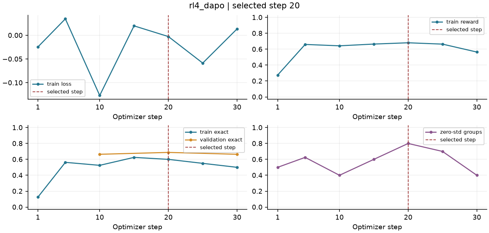
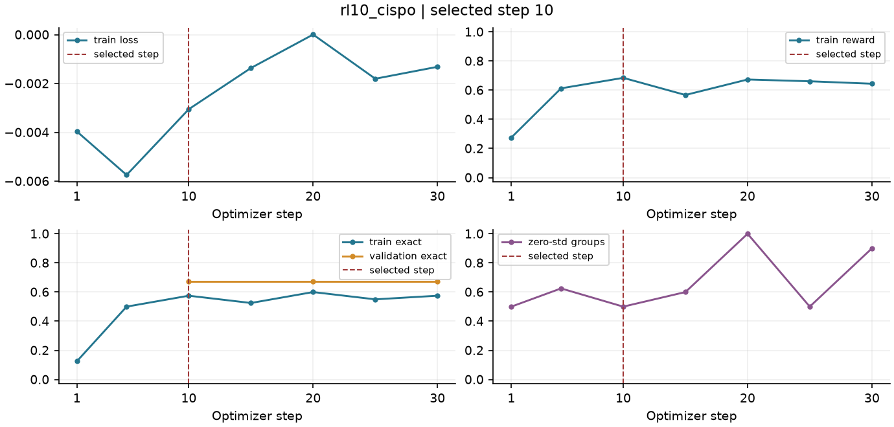
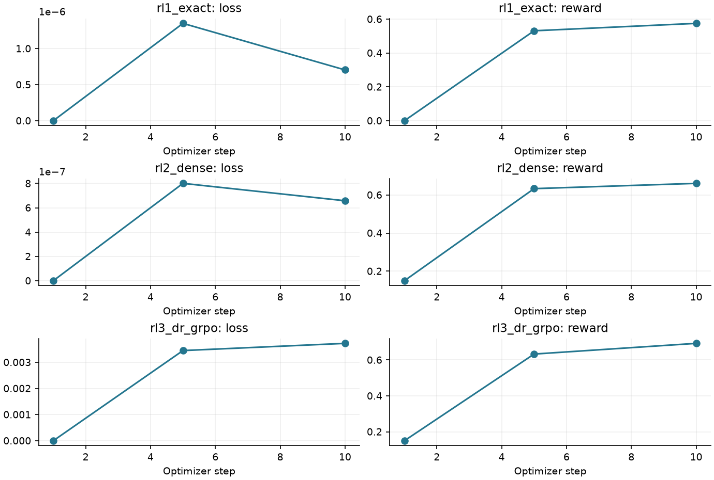

# Домашнее задание: RL для вызова инструментов

Решение использует только `Qwen/Qwen3.5-2B`, только ToolACE для обучения и RL через TRL.
SFT нет. BFCL используется только для итоговой оценки и разбора ошибок.
Исходные `evaluate.py`, `bfcl.jsonl` и `Dockerfile` не изменены.

## Выполненные запуски

Сохранены 13 завершённых обучений: три предварительных запуска по 10 шагов и десять основных по 30 шагов. Для baseline и всех десяти основных запусков есть метрики и по 350 ответов BFCL. Ниже приведены фактические настройки из `runs/*/config.json`, `trainer_args.json` и `selection.json`; новые обучения и оценки при подготовке отчёта не запускались.

Общие настройки основных запусков: Qwen/Qwen3.5-2B, seed=42, одна NVIDIA A100-SXM4-80GB; 9 415 train-примеров; 30 выбранных validation-промптов (27 с вызовом, 3 без вызова); 30 шагов, lr=1e-5, constant_with_warmup, warmup=3, gradient clipping=1.0, batch_size=4, gradient_accumulation=2, G=4, num_iterations=1. Эффективный батч — 8 ответов, то есть 2 промпта × 4 генерации на шаг. Генерация: vLLM, temperature=0.8, top_p=0.95, top_k=0, максимум 512 токенов; обрезанные completion маскируются. LoRA: r=16, alpha=32, dropout=0, BF16, attention SDPA, gradient_checkpointing=False; обучаются attention/MLP и проекции linear attention из сохранённого `lora_target_modules`. По умолчанию beta=0.01, epsilon=epsilon_high=0.2, token ratio. В таблице указаны исключения.

Проверка ToolACE и сохранение выполнялись через 10 шагов; выбран максимум `eval_quality/exact`, при равенстве сохранён более ранний максимум. Это sampling-метрика TRL по выбранной validation-подвыборке, а не BFCL и не простая доля из 30 текстовых ответов. Подвыборка одинакова у всех основных запусков; её ID сохранены в `runs/<имя>/validation_ids.jsonl`.

| Запуск / конфиг | Метод и отличия | Всего / выбранный шаг | Validation exact | Логи | BFCL |
| --- | --- | --- | --- | --- | --- |
| [rl1_exact_1](runs/rl1_exact_1/config.json) | GRPO; exact; group; точка сравнения наград | 30 / 10 | 0.6953 | [логи](runs/rl1_exact_1/logs.jsonl) | [метрики](results/rl1_exact_1/metrics.json), [ответы](results/rl1_exact_1/predictions.jsonl) |
| [rl2_dense_1](runs/rl2_dense_1/config.json) | GRPO; dense; group; общий контроль для RL-3–RL-10 | 30 / 30 | 0.6719 | [логи](runs/rl2_dense_1/logs.jsonl) | [метрики](results/rl2_dense_1/metrics.json), [ответы](results/rl2_dense_1/predictions.jsonl) |
| [rl3_dr_grpo_1](runs/rl3_dr_grpo_1/config.json) | Dr. GRPO; dense; scale=none; фиксированная нормировка loss | 30 / 10 | 0.6719 | [логи](runs/rl3_dr_grpo_1/logs.jsonl) | [метрики](results/rl3_dr_grpo_1/metrics.json), [ответы](results/rl3_dr_grpo_1/predictions.jsonl) |
| [rl4_dapo](runs/rl4_dapo/config.json) | DAPO loss; dense; epsilon_high=0.28 | 30 / 20 | 0.6875 | [логи](runs/rl4_dapo/logs.jsonl) | [метрики](results/rl4_dapo/metrics.json), [ответы](results/rl4_dapo/predictions.jsonl) |
| [rl5_no_kl](runs/rl5_no_kl/config.json) | GRPO; dense; beta=0 вместо 0.01 | 30 / 20 | 0.7422 | [логи](runs/rl5_no_kl/logs.jsonl) | [метрики](results/rl5_no_kl/metrics.json), [ответы](results/rl5_no_kl/predictions.jsonl) |
| [rl6_low_temperature](runs/rl6_low_temperature/config.json) | GRPO; dense; temperature=0.5 вместо 0.8 | 30 / 10 | 0.6797 | [логи](runs/rl6_low_temperature/logs.jsonl) | [метрики](results/rl6_low_temperature/metrics.json), [ответы](results/rl6_low_temperature/predictions.jsonl) |
| [rl7_learning_rate](runs/rl7_learning_rate/config.json) | GRPO; dense; lr=1e-5, как у RL-2; повтор конфигурации | 30 / 10 | 0.6875 | [логи](runs/rl7_learning_rate/logs.jsonl) | [метрики](results/rl7_learning_rate/metrics.json), [ответы](results/rl7_learning_rate/predictions.jsonl) |
| [rl8_no_reward_scaling](runs/rl8_no_reward_scaling/config.json) | GRPO; dense; scale=none вместо group | 30 / 10 | 0.7109 | [логи](runs/rl8_no_reward_scaling/logs.jsonl) | [метрики](results/rl8_no_reward_scaling/metrics.json), [ответы](results/rl8_no_reward_scaling/predictions.jsonl) |
| [rl9_gspo](runs/rl9_gspo/config.json) | GRPO; dense; sequence ratio вместо token ratio | 30 / 30 | 0.6719 | [логи](runs/rl9_gspo/logs.jsonl) | [метрики](results/rl9_gspo/metrics.json), [ответы](results/rl9_gspo/predictions.jsonl) |
| [rl10_cispo](runs/rl10_cispo/config.json) | CISPO; dense; верхний предел веса c=5 | 30 / 10 | 0.6719 | [логи](runs/rl10_cispo/logs.jsonl) | [метрики](results/rl10_cispo/metrics.json), [ответы](results/rl10_cispo/predictions.jsonl) |

Baseline: [метрики](results/base/metrics.json), [ответы](results/base/predictions.jsonl). Оценивалась исходная модель без обучения.

Предварительные запуски использовали lr=5e-6, warmup=1, максимум ответа 1024, use_vllm=False и 8 validation-промптов; остальные общие настройки см. в их конфигах. BFCL для этих запусков не приложен, поэтому они не включены в итоговую таблицу.

| Предварительный запуск / конфиг | Награда / loss / scale | Всего / выбранный шаг | Validation exact | Логи |
| --- | --- | --- | --- | --- |
| [rl1_exact](runs/rl1_exact/config.json) | exact / grpo / group | 10 / 10 | 0.9062 | [логи](runs/rl1_exact/logs.jsonl) |
| [rl2_dense](runs/rl2_dense/config.json) | dense / grpo / group | 10 / 10 | 0.8750 | [логи](runs/rl2_dense/logs.jsonl) |
| [rl3_dr_grpo](runs/rl3_dr_grpo/config.json) | dense / dr_grpo / none | 10 / 10 | 0.9375 | [логи](runs/rl3_dr_grpo/logs.jsonl) |

## Финальная таблица и отчёт

Лучшая из оценённых RL-моделей — **RL-5 (`rl5_no_kl`), шаг 20: overall 72,00%**, baseline — **68,27%**; прирост **3,73 процентного пункта**. Все десять RL-запусков имеют различающиеся результаты; RL-7 фактически повторяет настройки RL-2 и не является отдельной конфигурацией learning rate. Остаются девять различных RL-конфигураций — требование минимум трёх выполнено.

Готовые материалы: [PDF-отчёт с графиками](report/report.pdf), [отчёт в Markdown](report/report.md), [таблица CSV](report/summary.csv), [все ошибки RL-5 с эталонами](report/best_model_errors.jsonl), [проверка комплектности](report/audit.json).

### Результаты BFCL

Все значения — проценты. Overall перенесён из `metrics.json`: это среднее пяти групп, а не accuracy по всем 350 примерам. Multiple объединяет multiple и live_multiple (75+75), Irrel. — irrelevance и live_irrelevance (25+25); остальные группы содержат по 50 примеров.

| Запуск | Overall | Simple | Multiple | Parallel | Parallel + Multiple | Irrel. |
| --- | --- | --- | --- | --- | --- | --- |
| Baseline | 68.27 | 68.00 | 79.33 | 54.00 | 80.00 | 60.00 |
| RL-1 (rl1_exact_1) | 70.00 | 70.00 | 82.00 | 62.00 | 80.00 | 56.00 |
| RL-2 (rl2_dense_1) | 71.33 | 76.00 | 84.67 | 72.00 | 82.00 | 42.00 |
| RL-3 (rl3_dr_grpo_1) | 70.13 | 70.00 | 80.67 | 60.00 | 80.00 | 60.00 |
| RL-4 (rl4_dapo) | 71.87 | 72.00 | 83.33 | 70.00 | 80.00 | 54.00 |
| RL-5 (rl5_no_kl) | 72.00 | 76.00 | 84.00 | 70.00 | 82.00 | 48.00 |
| RL-6 (rl6_low_temperature) | 68.53 | 66.00 | 74.67 | 54.00 | 80.00 | 68.00 |
| RL-7 (rl7_learning_rate) | 70.00 | 68.00 | 82.00 | 60.00 | 80.00 | 60.00 |
| RL-8 (rl8_no_reward_scaling) | 70.13 | 70.00 | 82.67 | 62.00 | 80.00 | 56.00 |
| RL-9 (rl9_gspo) | 71.73 | 70.00 | 82.67 | 66.00 | 82.00 | 58.00 |
| RL-10 (rl10_cispo) | 70.53 | 70.00 | 82.67 | 62.00 | 80.00 | 58.00 |

У всех 11 оценок совпадают SHA-256 BFCL, ревизия базовой модели, версии библиотек и decoding: temperature=0, max_new_tokens=1024, enable_thinking=False, seed=42. В каждой оценке ровно 350 уникальных ID, совпадающих с `bfcl.jsonl`; число верных ответов по категориям сверено с predictions. Локальные `evaluate.py`, `bfcl.jsonl` и `Dockerfile` побайтно совпадают с выданными файлами в корневой папке. Сохранённого хеша исполнявшегося evaluate.py нет, поэтому это проверка текущих файлов и метаданных, а не полная аттестация удалённого запуска.

### Данные и EDA

Источник — только Team-ACE/ToolACE, revision `6bda777c88d21e5a204703c1ee45597a8fa4f734`, fingerprint `3ce5e883725cde98`. Базовая модель зафиксирована на `15852e8c16360a2fea060d615a32b45270f8a8fc`. По [EDA](report/data/eda.json) исходно 11 300 диалогов, удалены 3 точных дубликата. Уникальные диалоги отсортированы по SHA-256 содержимого, перемешаны с seed=42 и разделены до раскручивания: 10 168 train и 1 129 validation. Из диалогов получены префиксы истории перед ответом ассистента на пользовательский запрос; предыдущие вызовы и ответы инструментов сохраняются. Эталоны используются только для RL-награды, SFT не выполняется.

Отклонены 1 020 диалогов с ошибкой разбора; после раскручивания — 874 примера, эталоны которых не проходят обратный разбор, 11 слишком длинных промптов (>3072 токенов) и 3 длинных эталона (>1024). Это разные единицы учёта: диалоги и отдельные ответы. До фильтрации было 10 213/1 123 примера train/validation; после — 9 415/1 033. Статистика ниже взята из сохранённого EDA; полнота актуальных train/validation и основные распределения сверены с JSONL.

| После фильтрации | Train | Validation |
| --- | --- | --- |
| Примеры / диалоги | 9 415 / 8 488 | 1 033 / 945 |
| С вызовом / без вызова | 7 635 / 1 780 (18,91% без вызова) | 844 / 189 (18,30% без вызова) |
| Промпт: median / p95 / max, токены | 683 / 1377 / 3040 | 673 / 1319 / 2271 |
| Эталон: median / p95 / max, токены | 64 / 283 / 896 | 66 / 275 / 662 |
| Инструментов: mean / p95 / max | 3,23 / 6 / 9 | 3,12 / 6 / 8 |
| Уникальных имён инструментов | 14 208 | 2 571 |

В train 4 574 ответа с одним вызовом и 3 061 с несколькими (до 12); наиболее частые имена инструментов — Search (86), Get Supported Languages (63), Get Products in Category (39). Разделение по целому диалогу предотвращает попадание его разных префиксов в разные сплиты. По полным train/validation пересечение ID диалогов равно нулю; ID примеров уникальны, все диалоги соответствуют назначенному сплиту в dialogue_splits.jsonl. Обучение 30 шагов охватывает 60 предъявлений промптов при указанном эффективном батче; это короткий эксперимент, а не полный проход по train.

### Награда и примеры

Пусть E — точное равенство мультимножеств вызовов (имя и весь словарь аргументов), N — multiset F1 имён функций, A — multiset F1 троек (имя функции, имя аргумента, каноническое JSON-значение). F1 = 2 × число совпавших элементов с учётом повторов / (число предсказанных + число эталонных элементов). Порядок вызовов и ключей не влияет на оценку; дубликаты учитываются.

**Точная награда:** R_exact = E для валидного завершённого непустого ответа. **Частичная:** R_dense = 0.6E + 0.2N + 0.2A, если вызов нужен и предсказан. Когда эталон не содержит вызовов, обе награды равны 1 за корректный непустой текст без вызова и 0 за лишний вызов. Пустой, обрезанный, некорректно размеченный ответ, недоступная функция и отсутствие требуемого вызова получают 0.

Примеры ниже уже сохранены в [reward_examples.jsonl](report/data/reward_examples.jsonl); функция награды повторно не запускалась. Для call-эталона требуются три Get Cash Flow Key Stats с performanceId 12345, ABC678, XYZ910.

| Случай | Exact | Dense |
| --- | --- | --- |
| Три правильных вызова | 1 | 1 |
| Повтор первого вызова (4 вместо 3) | 0 | 0,3429 |
| Пропущен аргумент первого вызова | 0 | 0,36 |
| Текст вместо нужного вызова | 0 | 0 |
| Пустой / обрезанный ответ | 0 | 0 |
| Вызов не нужен, корректный текст | 1 | 1 |
| Вызов не нужен, вызвана функция | 0 | 0 |

Такая награда выбрана, чтобы точное совпадение оставалось главным сигналом, а частичное давало градиент при отсутствии полностью правильных ответов в группе. Ограничения: A агрегирует аргументы между вызовами одной функции и не гарантирует правильность их группировки; смысл текста без вызова не проверяется. ToolACE exact сравнивает конкретные значения и отличается от BFCL AST-checker с допустимыми альтернативами.

### Гипотезы и наблюдения по каждому запуску

**RL-1 (rl1_exact_1).** Гипотеза: Точная награда улучшит полный выбор функций и аргументов. Наблюдение: 70,00%, +1,73 п.п. к baseline; Parallel вырос с 54 до 62%, Irrel. снизился с 60 до 56%. Награда: exact; выбран шаг 10 из 30. [Графики loss, reward, exact и zero-std](report/figures/rl1_exact_1.png).

**RL-2 (rl2_dense_1).** Гипотеза: Частичная награда даст сигнал при отсутствии точных решений. Наблюдение: 71,33%, +1,33 п.п. к RL-1. Parallel 72% против 62%, но Irrel. 42% против 56%: больше правильных вызовов сопровождается лишними вызовами. Награда: dense; выбран шаг 30 из 30. [Графики loss, reward, exact и zero-std](report/figures/rl2_dense_1.png).

**RL-3 (rl3_dr_grpo_1).** Гипотеза: Нормировки Dr. GRPO уменьшат смещение по длине и сложности. Наблюдение: 70,13%, −1,20 п.п. к RL-2. Parallel 60%, Irrel. 60%; улучшения overall относительно GRPO dense не получено. Награда: dense; выбран шаг 10 из 30. [Графики loss, reward, exact и zero-std](report/figures/rl3_dr_grpo_1.png).

**RL-4 (rl4_dapo).** Гипотеза: Нормировка по токенам и широкий верхний clipping улучшат несколько вызовов. Наблюдение: 71,87%, +0,53 п.п. к RL-2; Parallel 70% против 72%, Parallel + Multiple 80% против 82%. Гипотеза именно о нескольких вызовах не подтвердилась; выигрыш overall связан с Irrel. 54% против 42%. Dynamic sampling и overlong reward shaping не реализованы. Награда: dense; выбран шаг 20 из 30. [Графики loss, reward, exact и zero-std](report/figures/rl4_dapo.png).

**RL-5 (rl5_no_kl).** Гипотеза: Без KL поведение изменится быстрее, но ответы без вызова могут ухудшиться. Наблюдение: 72,00%, +0,67 п.п. к RL-2, лучший overall. Irrel. 48% против 42% у RL-2, поэтому ожидаемое ухудшение относительно RL-2 не наблюдается; относительно baseline 60% регресс сохраняется. Награда: dense; выбран шаг 20 из 30. [Графики loss, reward, exact и zero-std](report/figures/rl5_no_kl.png).

**RL-6 (rl6_low_temperature).** Гипотеза: Низкая температура уменьшит ошибки формата ценой разнообразия. Наблюдение: 68,53%, −2,80 п.п. к RL-2; Irrel. растёт до 68%, Parallel падает до 54%. При полностью равных наградах на шагах 1 и 15 frac_reward_zero_std=1. Качество формата отдельно этой метрикой не доказано. Награда: dense; выбран шаг 10 из 30. [Графики loss, reward, exact и zero-std](report/figures/rl6_low_temperature.png).

**RL-7 (rl7_learning_rate).** Гипотеза: Увеличение learning rate ускорит рост качества. Наблюдение: 70,00%. Фактически lr=1e-5 у RL-7 и RL-2; остальные эффективные trainer_args тоже совпадают. Это повтор конфигурации; гипотеза про увеличение lr не проверена. Разница −1,33 п.п. показывает чувствительность результатов даже при совпадающих сохранённых настройках. Награда: dense; выбран шаг 10 из 30. [Графики loss, reward, exact и zero-std](report/figures/rl7_learning_rate.png).

**RL-8 (rl8_no_reward_scaling).** Гипотеза: Отключение деления advantage на std уменьшит усиление малых различий. Наблюдение: 70,13%, −1,20 п.п. к RL-2; улучшения overall нет. RL-3 относительно RL-8 дополнительно меняет нормировку loss: overall одинаков, но категории различаются. Награда: dense; выбран шаг 10 из 30. [Графики loss, reward, exact и zero-std](report/figures/rl8_no_reward_scaling.png).

**RL-9 (rl9_gspo).** Гипотеза: Sequence ratio стабилизирует обновления нескольких вызовов. Наблюдение: 71,73%, +0,40 п.п. к RL-2; Parallel 66% против 72%, Parallel + Multiple остаётся 82%. Лучшего результата на нескольких вызовах не получено; стабильность по одному seed не установлена. Награда: dense; выбран шаг 30 из 30. [Графики loss, reward, exact и zero-std](report/figures/rl9_gspo.png).

**RL-10 (rl10_cispo).** Гипотеза: Ограниченный отсоединённый вес сохранит сигнал за пределом clipping. Наблюдение: 70,53%, −0,80 п.п. к RL-2; выигрыша overall нет. Это проверка конфигурации CISPO с c=5, а не отдельная проверка сохранения градиента. Награда: dense; выбран шаг 10 из 30. [Графики loss, reward, exact и zero-std](report/figures/rl10_cispo.png).

### Ответы на вопросы и выводы

**1. Почему выбрана такая награда?** Exact соответствует цели получить весь набор вызовов, а dense добавляет частичный сигнал за верные имена и аргументы. Преобладающий вес exact=0.6 удерживает приоритет полного решения. Полученные оценки показывают компромисс: RL-2 лучше RL-1 на Parallel на 10 п.п., но хуже на Irrel. на 14 п.п.

**2. Какое изменение сильнее повлияло на качество?** Среди сравнений с общим контролем RL-2 наибольшее изменение overall даёт снижение температуры до 0.5: −2,80 п.п. Наибольший положительный эффект отдельного изменения в сопоставляемых конфигурациях — переход exact → dense (RL-1 → RL-2): +1,33 п.п. Лучший абсолютный результат даёт отключение KL: +0,67 п.п. к RL-2. В этих парах остальные сохранённые настройки совпадают; выбор шага входит в процедуру сравнения. Однако один seed, маленькая validation-подвыборка и разница 1,33 п.п. между одинаковыми конфигурациями RL-2/RL-7 не позволяют считать эти эффекты устойчиво установленными. RL-3 и RL-4 меняют несколько составляющих сразу, их эффект нельзя приписать одной из них.

**3. Совпадает ли рост награды с ростом BFCL?** Прямого соответствия не видно, а корреляцию во времени оценить нельзя: BFCL сохранён только для одного выбранного шага каждого запуска. У RL-6 train reward достигает 0,745 на шаге 15, но выбранный по validation шаг 10 даёт лишь 68,53% BFCL. У RL-5 reward на выбранном шаге 20 равен 0,6758, а BFCL выше — 72,00%. Эти числа относятся к разным шагам и не доказывают отрицательную корреляцию, но показывают, почему высокий train reward не является критерием выбора по BFCL. В RL-3 train exact растёт с 0,525 на шаге 10 до 0,625 на шаге 30, тогда как validation exact падает с 0,6719 до 0,6328. Дополнительное расхождение целей видно у RL-2: сокращается число ответов без нужного вызова (35 → 10 относительно baseline), но растут лишние вызовы в Irrelevance (17 → 27).

**4. Что происходит с advantage при одинаковых наградах?** Для всех ответов группы R_i − mean(R)=0, поэтому A_i=0 и при делении на std+delta, и без нормировки. Группа не даёт градиента от reward-части; при beta>0 KL может давать градиент. У RL-5 beta=0, поэтому такого KL-сигнала нет. Нулевой loss сам по себе не означает идеальное качество: в on-policy GRPO нормированные положительные и отрицательные advantage могут компенсироваться. Loss разных методов также имеет разные нормировки.

**5. Какие ошибки остались у лучшей модели?** У RL-5 правильны 264 из 350 ответов; ошибки — 25 лишних вызовов, 12 полных пропусков, 2 обрезанных ответа и 47 других ошибок функции, аргументов или разметки. Неполный набор вызовов с хотя бы одним вызовом попадает в последнюю группу. Доля 264/350 не равна overall=72%, потому что overall усредняет группы с разными размерами.

**simple_241.** Пропущенный вызов, Simple. На вопрос «Who was the U.S. president during the Civil War?» модель отвечает текстом про Abraham Lincoln. Эталон требует US_President_During_Event(event="Civil War"). Содержательно полезный ответ не выполняет требование использовать доступную функцию.

**simple_386.** Неверное значение, Simple. При бронировании Hotel Paradise модель передаёт room_type="luxury room" вместо допустимых "luxury"/"Luxury". Функция выбрана правильно, но значение аргумента не соответствует эталону.

**multiple_119.** Неверный тип вложенного аргумента, Multiple. database.query выбран правильно; в conditions модель передаёт value=25 как число, тогда как схема и эталон требуют строку "25". Частичное совпадение имени не решает проблему точности аргументов.

**parallel_105.** Комбинация аргументов, Parallel. В третьем calc_heat_capacity получены temp=350, volume=1.5, а эталон требует temp=300, volume=1.5. Формулировку о последовательных изменениях условий можно интерпретировать неоднозначно; фиксируем именно расхождение с AST-эталоном.

**parallel_multiple_75.** Неполный набор, Parallel + Multiple. Модель выдаёт только два chess_club_details.find для Boston и Philadelphia. Эталон содержит ещё три route_planner.calculate_route: New York → Boston, Boston → Philadelphia, Philadelphia → New York; вместо пяти вызовов получены два.

**irrelevance_205.** Лишний вызов, Irrelevance. На вопрос об авторе Pride and Prejudice вызван calculate_score(enemies_defeated=0, coins_collected=0, power_ups=0). Инструмент относится к видеоигре и не подходит запросу; эталон не содержит вызовов. Модель подставляет отсутствующие в запросе аргументы.

**live_irrelevance_479-135-1.** Обрезанный ответ, live Irrelevance. Вопрос о multi-cloud observability не требует доступного погодного инструмента. Вызова нет, но ответ достигает 1024 токенов и заканчивается с finish_reason="length", поэтому evaluator ставит 0. Проверка только отсутствия вызовов ошибочно сочла бы этот пример успешным.

### Комплектность и ограничения воспроизведения

Обучающий датасет не публикуется на GitHub: папка `data/` остаётся локально и исключена через `.gitignore`. Для воспроизведения выполните `prepare_data.py`, предварительно указав ToolACE revision `6bda777c88d21e5a204703c1ee45597a8fa4f734` в CONFIG[dataset_revision]. Безопасные материалы для отчёта сохранены отдельно: [EDA](report/data/eda.json), [manifest](report/data/manifest.json), [примеры награды](report/data/reward_examples.jsonl). В исходных данных обнаружена строка формата GitHub PAT; обучающие примеры и исходная выгрузка исключены из публикуемой истории.

Для содержательного отчёта файлов достаточно: baseline + 10 BFCL-оценок, полные predictions, конфиги, selection, логи, EDA и примеры награды присутствуют. Для сдачи приложены готовые PDF, таблица и графики. Новые обучения, экспорт и BFCL не выполнялись.

Актуальные данные проверены полностью: `data/train.jsonl` содержит 9 415 корректных JSON-строк (57 672 133 байта), `data/validation.jsonl` — 1 033 строки. Их SHA-256 совпадают с `data/manifest.json` и data_manifest всех 13 запусков: train — `1591e4a3727949567f41a574328adb7fa36d1308c67fc2f234f29d37ae47e6b9`, validation — `16edeee2481b10f2cd9c9dc164c6b404e69373b26ded3e16d46284c311de10d6`. Обрывов строк, повторяющихся ID примеров и пересечений диалогов между сплитами нет; число примеров, диалогов и распределения соответствуют EDA. Замечание о неполной локальной копии train снято.

После подготовки отчёта удалены служебные папки `runs/*/checkpoint-*` и `best_adapter`, состояния Trainer/оптимизатора, автосозданные карточки моделей и повторно скачиваемая исходная копия ToolACE в `data/raw`. Сохранены подготовленные train/validation, EDA, разбиение диалогов, конфиги, логи, selection, validation ID, исходники запусков и все BFCL-результаты. В `runs/` нет `adapter_model.safetensors` или `adapter_model.bin`, а папка `checkpoints/` с полными экспортированными моделями отсутствует. Для повторной оценки нужны веса выбранных LoRA-адаптеров и их merge либо полные HF-чекпоинты. В metrics записаны пути `./checkpoints/<имя>`, но по одним этим метаданным нельзя повторно проверить факт слияния весов. По условиям задания веса не перечислены среди обязательных файлов GitHub, поэтому их отсутствие не мешает прочитать сохранённые оценки, но мешает повторить их без обучения.

Зафиксированное окружение запусков: torch 2.11.0+cu129, transformers 5.9.0, TRL 1.16.0, PEFT 0.18.1, datasets 4.7.0, accelerate 1.10.1, vLLM 0.22.0+cu129, bfcl-eval 2026.3.23, numpy 2.2.6. Текущие CONFIG не заменяют архив настроек: источники конкретного запуска сохранены в `runs/<имя>/source/`, эффективные аргументы — в `trainer_args.json`. Значения версий взяты из логов запусков; библиотеки обучения при подготовке отчёта не импортировались.

### Графики основных запусков

На каждом рисунке показаны train loss, train reward, train/validation exact и доля групп с нулевым std награды; пунктир отмечает выбранный шаг. Точки соединены для чтения, новых измерений между ними нет. Логирование: шаг 1, затем 5, 10, 15, 20, 25, 30; validation — 10, 20, 30. Кривые train получены на меняющихся батчах, поэтому их колебания нельзя трактовать как динамику на фиксированной выборке. Награда RL-1 exact отличается от dense остальных запусков; для сопоставления полезнее общая компонента quality/exact. BFCL-кривой по шагам нет.







### Графики предварительных запусков

Три отдельных запуска по 10 шагов; выбран шаг 10 у каждого. Их validation exact (0,90625 / 0,875 / 0,9375) нельзя напрямую сравнивать с основной серией: подвыборка содержит 8 промптов вместо 30, отличаются lr, длина генерации и генерационный backend.



## Файлы

| Файл | Назначение |
| --- | --- |
| `config.py` | Общие пути, seed, модель, активный эксперимент |
| `prepare_data.py` | Скачивание ToolACE, разделение, фильтрация, EDA |
| `toolace.py` | Разбор функций и диалогов, преобразование истории в формат Qwen |
| `rewards.py` | Точная и частичная награды |
| `train.py` | Один запуск GRPO/Dr. GRPO с LoRA |
| `export_model.py` | Слияние выбранного адаптера с исходной моделью |
| `evaluate.py` | Выданная оценка BFCL, без изменений |
| `make_report.py` | Исходный шаблон HTML; готовые результаты см. в `report/` |
| `utils.py` | Чтение и сохранение JSON, хеши и версии |

Настраиваемые параметры находятся в словарях `CONFIG` в начале соответствующих `.py`.
Десять конфигураций и их гипотезы находятся в `EXPERIMENTS` в начале `train.py`.
Собственные скрипты не требуют аргументов командной строки.

## 1. Окружение

Используйте выданный Dockerfile на Linux-машине с NVIDIA GPU и поддержкой BF16.
На Mac можно редактировать код, но приведённое обучение и vLLM-оценка требуют CUDA.
Дополнительные зависимости не добавлены: отчёт строится стандартной библиотекой Python.

Из папки проекта:

```bash
docker build -t rlvr-homework .
docker run --rm -it --gpus device=0 --ipc=host \
  -v "$PWD":/workspace -v rlvr-hf-cache:/cache rlvr-homework
```

Замените `device=0` на выделенную GPU. Все следующие команды выполняются внутри
контейнера из `/workspace`. Скрипт обучения рассчитан на **одну видимую GPU**.
Если запускаете вне Docker на подходящем окружении, ограничьте видимость через
`CUDA_VISIBLE_DEVICES=0`. Не используйте `torchrun` для этого решения.

Основные версии уже зафиксированы Dockerfile:

| Библиотека | Версия |
| --- | --- |
| TRL | 1.16.0 |
| Transformers | 5.9.0 |
| PEFT | 0.18.1 |
| vLLM | 0.22.0 |
| datasets | 4.7.0 |
| accelerate | 1.10.1 |
| bfcl-eval | 2026.3.23 |
| NumPy | 2.2.6 |

Полные фактические версии сохраняются при подготовке и обучении. Модель и токенизатор
загружаются с ревизией `15852e8c16360a2fea060d615a32b45270f8a8fc`, как в evaluator.
Seed по умолчанию — `42`. Одинаковый seed не гарантирует побитового совпадения на разных GPU.

Первый запуск скачает модель и датасет в `/cache` (Docker volume `rlvr-hf-cache`).
Подготовленные данные и результаты сохраняются в смонтированную папку проекта,
поэтому останутся после выхода из контейнера.

## 2. Оценка исходной модели

```bash
python3 evaluate.py Qwen/Qwen3.5-2B --output results/base
```

Результат: `results/base/metrics.json` и `results/base/predictions.jsonl`.
Не меняйте бенчмарк, tokenizer, evaluator или его настройки генерации.
В нём уже заданы `temperature=0`, `enable_thinking=False` и 1024 новых токена.
`overall` — среднее по пяти группам; внутри группы сначала усредняются её категории.
Не заменяйте эту метрику общей долей верных ответов по 350 строкам.

## 3. Подготовка данных

```bash
python3 prepare_data.py
```

Что происходит:

1. Разрешается ревизия `Team-ACE/ToolACE` в конкретный commit SHA, скачивается `train`.
   Копия исходного датасета сохраняется в `data/raw/`.
2. Удаляются точные дубликаты **целых диалогов**. Уникальные диалоги с seed 42
   делятся на 90% train и 10% validation до получения отдельных примеров.
3. Из поля `system` извлекается JSON со схемами инструментов. Исходная инструкция
   отвечать в Python-подобном формате не переносится: применяется исходный chat template Qwen.
4. Для каждого ответа ассистента непосредственно после пользователя создаётся пример:
   вся предыдущая история и инструменты → ожидаемые вызовы или отсутствие вызова.
   Пересказы результатов после `tool` не становятся отдельными целями, но сохраняются в истории.
5. Имена функций с пробелами поддерживаются. Аргументы читаются через AST как литералы;
   код из датасета не исполняется. Вызовы в истории переводятся в XML-формат Qwen.
6. Удаляются неподдерживаемые диалоги, примеры с промптом длиннее 3072 токенов или
   эталоном длиннее 1024 токенов. Длинные промпты не обрезаются.
   Также удаляются эталоны, которые после преобразования не разбираются обратно
   в тот же набор вызовов парсером vLLM. Причины сохраняются.

Один диалог целиком принадлежит одному сплиту. Поля `tools_json` и `expected_json`
хранятся строками JSON, чтобы Arrow не дополнял неоднородные аргументы значениями `null`.
`prompt` — уже сформированная строка с chat template; TRL не применяет шаблон второй раз.
`reference` и `expected_json` не добавляются в текущий промпт и не используются как SFT labels.

Основные файлы:

| Путь | Содержимое |
| --- | --- |
| `data/train.jsonl` | Примеры обучения |
| `data/validation.jsonl` | Отложенные примеры |
| `data/dialogue_splits.jsonl` | Принадлежность диалогов сплитам и исходные индексы |
| `data/rejected.jsonl` | Отфильтрованные записи и причины |
| `data/eda.json` | Размеры до/после фильтрации, длины, вызовы, инструменты |
| `data/reward_examples.jsonl` | Награды для эталонов, пропусков, повторов и повреждённых ответов |
| `data/manifest.json` | Ревизия ToolACE, настройки, версии и SHA256 файлов |

Для точного повторения скопируйте `dataset_revision` из `manifest.json` в
`prepare_data.py → CONFIG["dataset_revision"]`. Сохранённые train/validation используются
во всех десяти экспериментах без повторной подготовки.

Скрипт не перезаписывает существующие данные. Для другого разбиения или фильтров
задайте новую папку `data_dir` в `config.py`, затем снова подготовьте данные.
Изменение seed также требует новой подготовки.

## 4. Награда

Генерация разбирается через `Qwen3CoderToolParser`, как в evaluator.
В награду передаются исходные `completion_ids`: декодирование с
`skip_special_tokens=False` сохраняет специальные `<tool_call>`-теги.
Отсутствие завершающего EOS означает незавершённую генерацию и даёт нулевую награду.

Для примера с нужным вызовом:

```text
R_exact = 1, если весь набор вызовов совпал; иначе 0.
R_dense = 0.6 * exact + 0.2 * names_f1 + 0.2 * arguments_f1.
F1 = 2 * количество совпавших элементов / (число предсказанных + число эталонных).
```

`names_f1` сравнивает мультимножества имён функций. `arguments_f1` сравнивает
мультимножества троек `(имя функции, имя аргумента, значение)`.
Для двух пустых мультимножеств F1 равен 1. Повторные вызовы учитываются;
порядок вызовов и ключей словаря не важен. Порядок элементов аргумента-списка важен.
Значения сравниваются по канонической JSON-записи: например, `1` и `1.0` различаются.
При ожидаемом вызове ответ без вызовов всегда получает 0.

Если вызов не нужен, обе награды дают 1 за непустой текст без вызова и 0 за вызов.
Смысл этого текста не оценивается. Пустые, обрезанные ответы, некорректные теги,
недоступные функции и повторные параметры дают 0. Старый ответ вида `[func(...)]`
не считается корректным текстовым отказом.

Частичная награда помогает отличать почти правильный вызов от полностью неверного.
Её ограничение: тройки аргументов не сохраняют принадлежность конкретному вызову,
если одна функция вызывается несколько раз. Это проверяет только `exact`.
Сравнение ToolACE не тождественно официальному AST-checker BFCL, который допускает
альтернативные аргументы. Поэтому рост обучающей награды не гарантирует рост BFCL.

Веса меняются в `rewards.py → CONFIG`. Их сумма по умолчанию равна 1.
В `reward_examples.jsonl` также сохраняются отдельные компоненты награды.

## 5. Десять экспериментов

| Имя | Награда | Loss | Масштабирование advantage | Гипотеза |
| --- | --- | --- | --- | --- |
| `rl1_exact_1` | exact | grpo | group | Точное совпадение улучшает полный вызов |
| `rl2_dense_1` | dense | grpo | group | Частичная награда даёт более частый сигнал |
| `rl3_dr_grpo_1` | dense | dr_grpo | none | Нормировки Dr. GRPO уменьшают смещение по длине/сложности |
| `rl4_dapo` | dense | dapo | group | Нормировка по токенам и epsilon_high=0.28 улучшают несколько вызовов |
| `rl5_no_kl` | dense | grpo | group | beta=0 ускоряет изменение поведения, но может ухудшить ответы без вызова |
| `rl6_low_temperature` | dense | grpo | group | temperature=0.5 уменьшает ошибки формата ценой разнообразия |
| `rl7_learning_rate` | dense | grpo | group | lr=1e-5 совпал с RL-2; эффект увеличения lr не проверен |
| `rl8_no_reward_scaling` | dense | grpo | none | Отключение масштабирования advantage уменьшает усиление малых различий награды |
| `rl9_gspo` | dense | grpo + sequence ratio | group | Отношение вероятностей на уровне ответа стабилизирует обновления |
| `rl10_cispo` | dense | cispo | group | Отсоединённый ограниченный вес сохраняет градиент log-probability |

У RL-1 и RL-2 отличается только награда. У RL-2 и RL-3 меняются две составляющие
Dr. GRPO: advantage не делится на std, а loss нормируется фиксированной максимальной
длиной ответа. Это сравнение метода в целом, не отдельных эффектов этих двух изменений.
Все запуски стартуют с одной исходной модели, не продолжают друг друга.

RL-2 — общая точка сравнения для новых конфигураций. RL-5 и RL-6 меняют по одному гиперпараметру.
В фактическом RL-7 learning rate совпал с RL-2; это повтор конфигурации. RL-8 меняет только масштабирование advantage, поэтому
сравнение RL-8 с RL-3 отдельно показывает влияние нормировки loss.
RL-4 меняет нормировку loss и верхний clipping; это не полное воспроизведение DAPO:
dynamic sampling и overlong reward shaping не реализованы.

Таким образом, включены все пять методов из задания: GRPO, Dr. GRPO, DAPO,
GSPO и CISPO. В описании задания указан **CISPO**, а не GISPO; отдельного
варианта `gispo` в `GRPOConfig` TRL 1.16.0 нет.

GSPO в TRL задаётся сочетанием `loss_type="grpo"` и
`importance_sampling_level="sequence"`. В RL-9 по сравнению с RL-2 меняется только
уровень отношения вероятностей; границы clipping остаются `epsilon=epsilon_high=0.2`.
Это контролируемое сравнение ratio, а не воспроизведение всех гиперпараметров статьи GSPO.

CISPO в RL-10 задаётся `loss_type="cispo"` с токенным ratio. В TRL 1.16.0
`epsilon_high=5.0` здесь означает непосредственно верхний предел веса `c=5.0`,
а не `1 + epsilon_high`. Вес `min(ratio, c)` отсоединяется от графа градиентов,
после чего умножается на advantage и log-probability. Нормировка идёт по токенам.
В отличие от GRPO, нижний `epsilon` не задаёт границу CISPO clipping.
Эти настройки сверены с [исходником GRPOTrainer 1.16.0](https://github.com/huggingface/trl/blob/v1.16.0/trl/trainer/grpo_trainer.py).

Параметры конкретного опыта указаны в `EXPERIMENTS[имя]["overrides"]`.
Они заменяют соответствующие значения общего `CONFIG` при создании TRL-конфигурации.
В `runs/<имя>/config.json` сохраняются уже итоговые значения с учётом замен.

Сначала оставьте в `config.py`:

```python
"experiment": "rl1_exact_1",
```

Запустите обучение и экспорт:

```bash
python3 train.py
python3 export_model.py
python3 evaluate.py ./checkpoints/rl1_exact_1 --output results/rl1_exact_1
```

Затем измените `experiment` в `config.py` на `rl2_dense_1`:

```bash
python3 train.py
python3 export_model.py
python3 evaluate.py ./checkpoints/rl2_dense_1 --output results/rl2_dense_1
```

И повторите с `"experiment": "rl3_dr_grpo_1"`:

```bash
python3 train.py
python3 export_model.py
python3 evaluate.py ./checkpoints/rl3_dr_grpo_1 --output results/rl3_dr_grpo_1
```

Для RL-4–RL-10 последовательно задавайте в `config.py → CONFIG["experiment"]`
имена из таблицы. Для каждого имени выполняйте `python3 train.py`, затем
`python3 export_model.py` и оценку соответствующей папки:

```bash
python3 evaluate.py ./checkpoints/rl4_dapo --output results/rl4_dapo
python3 evaluate.py ./checkpoints/rl5_no_kl --output results/rl5_no_kl
python3 evaluate.py ./checkpoints/rl6_low_temperature --output results/rl6_low_temperature
python3 evaluate.py ./checkpoints/rl7_learning_rate --output results/rl7_learning_rate
python3 evaluate.py ./checkpoints/rl8_no_reward_scaling --output results/rl8_no_reward_scaling
python3 evaluate.py ./checkpoints/rl9_gspo --output results/rl9_gspo
python3 evaluate.py ./checkpoints/rl10_cispo --output results/rl10_cispo
```

Каждая команда оценки предполагает, что соответствующая модель уже обучена и экспортирована.

Вызовы последовательные: каждый процесс освобождает память до следующего.
При повторном запуске скрипты обучения и экспорта откажутся перезаписывать прежнюю папку.
Для нового опыта добавьте новое имя в `train.py → EXPERIMENTS`, выберите его в
`config.py`, а для включения в отчёт — в `make_report.py → CONFIG["runs"]`.
Автоматическое продолжение прерванного обучения здесь не реализовано.