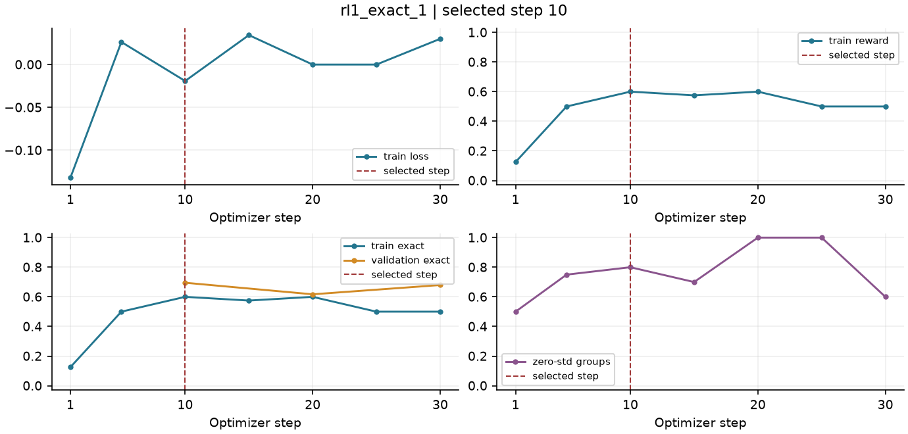
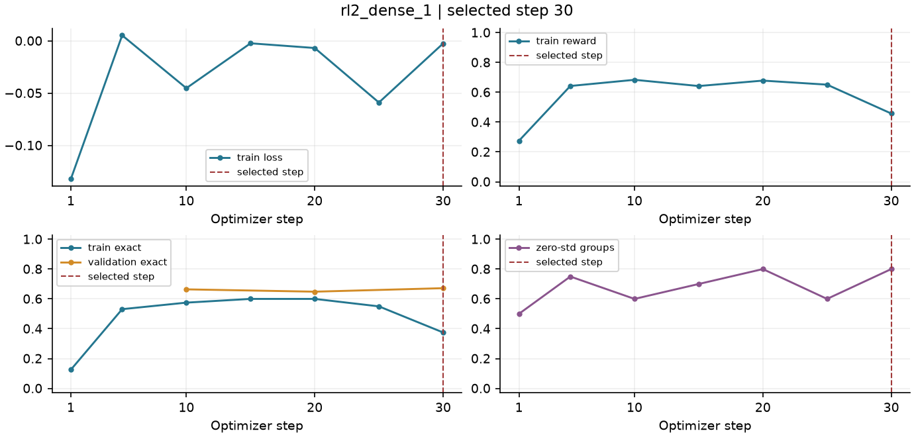
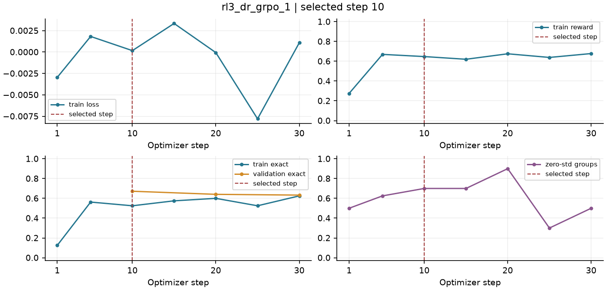
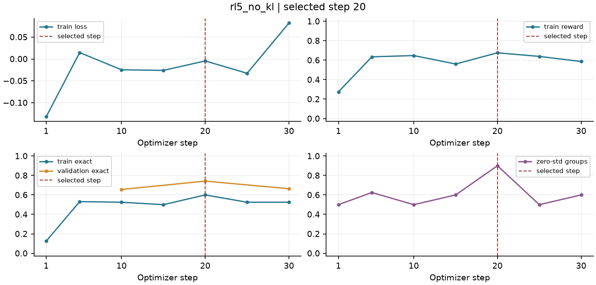
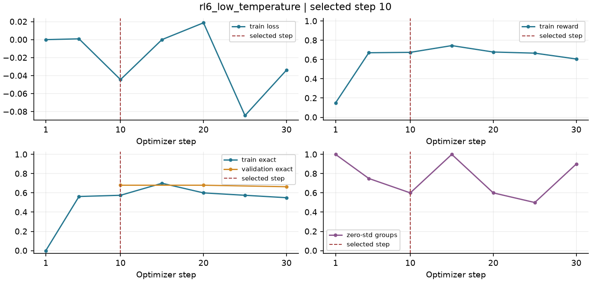
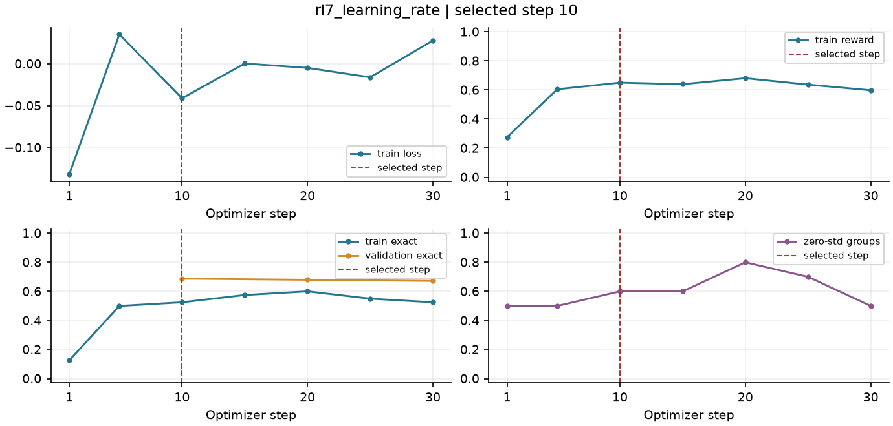
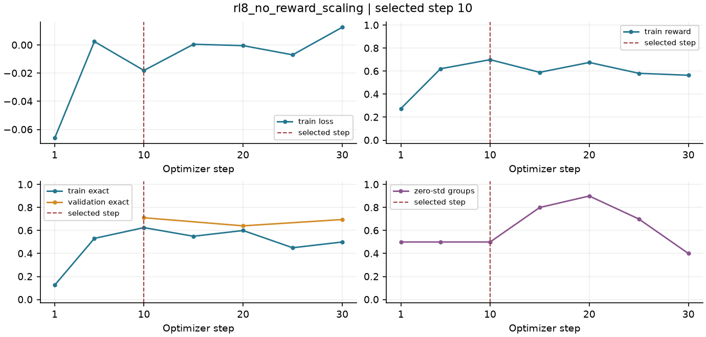
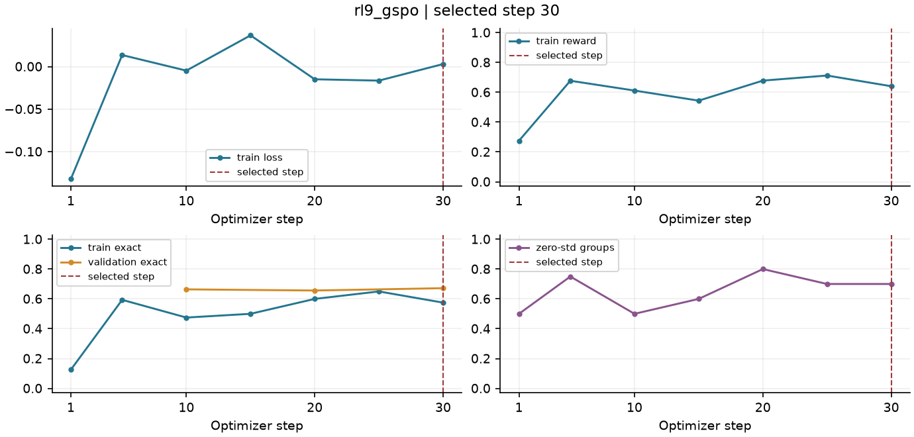

# RL для вызова инструментов

Qwen/Qwen3.5-2B · ToolACE · RL через TRL · оценка BFCL.

## Материалы

- **Отчёт:** [PDF](report/report.pdf), [итоговая таблица CSV](report/summary.csv), [графики](report/figures/).
- **Код:** [подготовка данных](prepare_data.py), [разбор ToolACE](toolace.py), [награды](rewards.py), [обучение](train.py), [экспорт модели](export_model.py), [оценка BFCL](evaluate.py).
- **Воспроизведение:** [общий конфиг](config.py), [Dockerfile](Dockerfile), [конфиги и логи запусков](runs/).
- **Результаты:** [метрики и ответы BFCL](results/), [EDA](report/data/eda.json), [manifest](report/data/manifest.json), [разбор ошибок](report/best_model_errors.jsonl), [проверки](report/audit.json).

## Запуски

Проведены 10 RL-запусков по 30 шагов. Для baseline и каждого выбранного чекпоинта сохранены метрики и 350 ответов BFCL.

| Параметры | Значение |
| --- | --- |
| Модель и обучение | Qwen/Qwen3.5-2B; TRL 1.16.0; одна A100-SXM4-80GB; BF16; seed=42 |
| Обновления | lr=1e-5; constant_with_warmup; warmup=3; gradient clipping=1 |
| Батч | batch_size=4; accumulation=2; G=4; num_iterations=1; 2 промпта × 4 ответа на шаг |
| Генерация при обучении | vLLM; temperature=0.8; top_p=0.95; top_k=0; до 512 токенов; обрезанные ответы маскируются |
| LoRA | r=16; alpha=32; dropout=0; attention/MLP и linear-attention проекции |
| По умолчанию | beta=0.01; epsilon=epsilon_high=0.2; token ratio |
| Выбор шага | Максимум eval_quality/exact на 30 ToolACE-промптах; оценка через 10 шагов |

В таблице указаны отличия от общих настроек. Validation-подвыборка одинакова: 27 запросов с вызовом и 3 без вызова. Полные параметры и ID примеров находятся в `runs/<имя>/`.

| Запуск / конфиг | Метод и отличия | Шаг | Val. exact | Результаты |
| --- | --- | --- | --- | --- |
| RL-1: [rl1_exact_1](runs/rl1_exact_1/config.json) | GRPO, exact, scale=group | 10 | 0.6953 | [логи](runs/rl1_exact_1/logs.jsonl) · [BFCL](results/rl1_exact_1/metrics.json) · [ответы](results/rl1_exact_1/predictions.jsonl) |
| RL-2: [rl2_dense_1](runs/rl2_dense_1/config.json) | GRPO, dense, scale=group; контроль | 30 | 0.6719 | [логи](runs/rl2_dense_1/logs.jsonl) · [BFCL](results/rl2_dense_1/metrics.json) · [ответы](results/rl2_dense_1/predictions.jsonl) |
| RL-3: [rl3_dr_grpo_1](runs/rl3_dr_grpo_1/config.json) | Dr. GRPO, dense, scale=none | 10 | 0.6719 | [логи](runs/rl3_dr_grpo_1/logs.jsonl) · [BFCL](results/rl3_dr_grpo_1/metrics.json) · [ответы](results/rl3_dr_grpo_1/predictions.jsonl) |
| RL-4: [rl4_dapo](runs/rl4_dapo/config.json) | DAPO loss, dense, epsilon_high=0.28 | 20 | 0.6875 | [логи](runs/rl4_dapo/logs.jsonl) · [BFCL](results/rl4_dapo/metrics.json) · [ответы](results/rl4_dapo/predictions.jsonl) |
| RL-5: [rl5_no_kl](runs/rl5_no_kl/config.json) | GRPO, dense, beta=0 | 20 | 0.7422 | [логи](runs/rl5_no_kl/logs.jsonl) · [BFCL](results/rl5_no_kl/metrics.json) · [ответы](results/rl5_no_kl/predictions.jsonl) |
| RL-6: [rl6_low_temperature](runs/rl6_low_temperature/config.json) | GRPO, dense, temperature=0.5 | 10 | 0.6797 | [логи](runs/rl6_low_temperature/logs.jsonl) · [BFCL](results/rl6_low_temperature/metrics.json) · [ответы](results/rl6_low_temperature/predictions.jsonl) |
| RL-7: [rl7_learning_rate](runs/rl7_learning_rate/config.json) | GRPO, dense; без изменений относительно RL-2 | 10 | 0.6875 | [логи](runs/rl7_learning_rate/logs.jsonl) · [BFCL](results/rl7_learning_rate/metrics.json) · [ответы](results/rl7_learning_rate/predictions.jsonl) |
| RL-8: [rl8_no_reward_scaling](runs/rl8_no_reward_scaling/config.json) | GRPO, dense, scale=none | 10 | 0.7109 | [логи](runs/rl8_no_reward_scaling/logs.jsonl) · [BFCL](results/rl8_no_reward_scaling/metrics.json) · [ответы](results/rl8_no_reward_scaling/predictions.jsonl) |
| RL-9: [rl9_gspo](runs/rl9_gspo/config.json) | GSPO: sequence ratio, dense | 30 | 0.6719 | [логи](runs/rl9_gspo/logs.jsonl) · [BFCL](results/rl9_gspo/metrics.json) · [ответы](results/rl9_gspo/predictions.jsonl) |
| RL-10: [rl10_cispo](runs/rl10_cispo/config.json) | CISPO, dense, c=5 | 10 | 0.6719 | [логи](runs/rl10_cispo/logs.jsonl) · [BFCL](results/rl10_cispo/metrics.json) · [ответы](results/rl10_cispo/predictions.jsonl) |

Baseline: [метрики](results/base/metrics.json), [ответы](results/base/predictions.jsonl).

## Результаты BFCL

**Лучший результат — RL-5, шаг 20: overall 72,00% против 68,27% у baseline (+3,73 п.п.).**

| Запуск | Overall | Simple | Multiple | Parallel | Parallel + Multiple | Irrel. |
| --- | --- | --- | --- | --- | --- | --- |
| Baseline | 68.27 | 68.00 | 79.33 | 54.00 | 80.00 | 60.00 |
| RL-1 | 70.00 | 70.00 | 82.00 | 62.00 | 80.00 | 56.00 |
| RL-2 | 71.33 | 76.00 | 84.67 | 72.00 | 82.00 | 42.00 |
| RL-3 | 70.13 | 70.00 | 80.67 | 60.00 | 80.00 | 60.00 |
| RL-4 | 71.87 | 72.00 | 83.33 | 70.00 | 80.00 | 54.00 |
| RL-5 | 72.00 | 76.00 | 84.00 | 70.00 | 82.00 | 48.00 |
| RL-6 | 68.53 | 66.00 | 74.67 | 54.00 | 80.00 | 68.00 |
| RL-7 | 70.00 | 68.00 | 82.00 | 60.00 | 80.00 | 60.00 |
| RL-8 | 70.13 | 70.00 | 82.67 | 62.00 | 80.00 | 56.00 |
| RL-9 | 71.73 | 70.00 | 82.67 | 66.00 | 82.00 | 58.00 |
| RL-10 | 70.53 | 70.00 | 82.67 | 62.00 | 80.00 | 58.00 |

Все значения — проценты. Overall — среднее точностей пяти групп. Multiple содержит 150 примеров, остальные группы — по 50. Параметры оценки едины: temperature=0, max_new_tokens=1024, thinking=False, seed=42. Хеш BFCL, ревизия модели и версии библиотек совпадают; метрики сверены с сохранёнными ответами.

## Данные

Использован только Team-ACE/ToolACE (revision `6bda777c88d21e5a204703c1ee45597a8fa4f734`); модель — revision `15852e8c16360a2fea060d615a32b45270f8a8fc`. Точные дубликаты удалены до разбиения; диалоги разделены 90/10 с seed=42. Каждый ответ ассистента превращён в RL-пример: история диалога и инструменты — промпт, исходный вызов — эталон награды. Части одного диалога не пересекают сплиты. SFT не используется.

| Показатель | Train | Validation |
| --- | --- | --- |
| Примеры / диалоги после фильтрации | 9 415 / 8 488 | 1 033 / 945 |
| С вызовом / без вызова | 7 635 / 1 780 | 844 / 189 |
| Промпт: median / p95, токены | 683 / 1377 | 673 / 1319 |
| Эталон: median / p95, токены | 64 / 283 | 66 / 275 |
| Инструментов: mean / max | 3,23 / 9 | 3,12 / 8 |

Исходно 11 300 диалогов; удалены 3 дубликата и 1 020 диалогов с ошибкой разбора. После раскручивания исключены 874 эталона, не проходящих обратный разбор, 11 промптов длиннее 3072 токенов и 3 эталона длиннее 1024 токенов. Хеши полных train/validation соответствуют manifest; пересечений диалогов нет. Подробности: [EDA](report/data/eda.json), [manifest](report/data/manifest.json).

## Награда

E — точное совпадение мультимножеств вызовов; N — multiset F1 имён функций; A — multiset F1 троек (функция, аргумент, JSON-значение). Порядок вызовов не важен, повторы учитываются. F1 = 2 × число совпадений / суммарное число предсказанных и эталонных элементов.

**R_exact = E. R_dense = 0.6E + 0.2N + 0.2A.** Для примеров без вызова награда равна 1 за корректный непустой текст без вызовов. Пустой, обрезанный или некорректно размеченный ответ, лишний вызов при пустом эталоне и отсутствие нужного вызова получают 0.

| Пример | Exact | Dense |
| --- | --- | --- |
| Три правильных вызова | 1 | 1 |
| Повтор одного из трёх вызовов | 0 | 0,3429 |
| Пропуск одного аргумента | 0 | 0,36 |
| Нет нужного вызова / пустой / обрезанный ответ | 0 | 0 |
| Вызов не нужен: текст / лишний вызов | 1 / 0 | 1 / 0 |

[Сохранённые примеры награды](report/data/reward_examples.jsonl). Dense даёт частичный сигнал, когда полных совпадений ещё нет. Ограничения: A не проверяет совместную принадлежность аргументов одному вызову; смысл текста без вызова не оценивается. ToolACE exact отличается от BFCL AST-checker с допустимыми альтернативами.

## Гипотезы и наблюдения

| Запуск | Гипотеза / сравнение | Наблюдение |
| --- | --- | --- |
| RL-1 | Точная награда улучшит полный вызов | +1,73 п.п. к baseline; Parallel +8 п.п. |
| RL-2 | Частичная награда даст более частый сигнал | +1,33 п.п. к RL-1; Parallel +10, Irrel. −14 п.п. |
| RL-3 | Dr. GRPO уменьшит смещение по длине и сложности | −1,20 п.п. к RL-2 |
| RL-4 | Нормировка по токенам и широкий clipping улучшат несколько вызовов | +0,53 п.п. к RL-2; Parallel −2, Irrel. +12 п.п. |
| RL-5 | Отключение KL ускорит изменение поведения | +0,67 п.п. к RL-2; лучший overall |
| RL-6 | Низкая температура снизит ошибки ценой разнообразия | −2,80 п.п. к RL-2; Parallel −18, Irrel. +26 п.п. |
| RL-7 | Без изменений относительно RL-2 | Overall 70,00%; −1,33 п.п. к RL-2 |
| RL-8 | Отказ от деления advantage на std улучшит обновления | −1,20 п.п. к RL-2 |
| RL-9 | Sequence ratio улучшит несколько вызовов | +0,40 п.п. к RL-2; Parallel −6 п.п. |
| RL-10 | CISPO сохранит градиент за пределом clipping | −0,80 п.п. к RL-2 |

В RL-4 использованы DAPO loss и раздельный clipping; dynamic sampling и overlong reward shaping не реализованы. RL-3 и RL-4 меняют несколько составляющих, поэтому их эффекты нельзя приписать одной из них.

## Выводы

**1. Почему такая награда?** Exact проверяет всё решение, dense добавляет сигнал за верные функции и аргументы. Вес exact=0.6 сохраняет приоритет полного вызова. Улучшение Parallel у RL-2 сопровождается ухудшением Irrelevance.

**2. Что повлияло сильнее всего?** Среди сравнений с RL-2 наибольшее изменение даёт температура 0.5: −2,80 п.п. Переход exact → dense даёт +1,33 п.п.; отключение KL — ещё +0,67 п.п. В соответствующих парах меняется один фактор. Один seed, короткое обучение и выбор шага по небольшой validation-подвыборке ограничивают устойчивость выводов.

**3. Совпадает ли рост награды с BFCL?** Высокая train reward не гарантирует лучший BFCL. У RL-6 reward достигает 0,745 на шаге 15, но выбранный шаг 10 даёт 68,53% BFCL; у RL-5 reward на выбранном шаге 20 — 0,6758, BFCL — 72,00%. Это разные шаги; корреляцию во времени установить нельзя, поскольку BFCL измерен только для выбранного чекпоинта. У RL-3 train exact растёт с 0,525 до 0,625 между шагами 10 и 30, а validation exact падает с 0,6719 до 0,6328.

**4. Что при одинаковых наградах?** R_i − mean(R)=0, поэтому advantage всех ответов группы равен нулю. Reward-часть не даёт градиента; при beta>0 остаётся возможный вклад KL. У RL-5 beta=0.

**5. Какие ошибки остались?** У RL-5 верны 264 из 350 ответов. Ошибки: 25 лишних вызовов, 12 полных пропусков, 2 обрезанных ответа и 47 ошибок функции, аргументов или разметки. Примеры ниже; полный разбор — в [best_model_errors.jsonl](report/best_model_errors.jsonl).

| ID / категория | Ошибка RL-5 |
| --- | --- |
| simple_241 / Simple | Текст про Abraham Lincoln вместо US_President_During_Event(event="Civil War"). |
| simple_386 / Simple | room_type="luxury room" вместо допустимых "luxury"/"Luxury". |
| multiple_119 / Multiple | database.query: value=25 числом вместо строки "25". |
| parallel_105 / Parallel | Третий вызов: temp=350, volume=1.5; эталон требует temp=300. Формулировка допускает неоднозначное прочтение. |
| parallel_multiple_75 / Parallel + Multiple | Выданы два chess_club_details.find; пропущены три route_planner.calculate_route. |
| irrelevance_205 / Irrelevance | На вопрос об авторе Pride and Prejudice вызван неподходящий calculate_score с выдуманными аргументами. |
| live_irrelevance_479-135-1 / Irrelevance | Вызова нет, но ответ обрезан на 1024 токенах: finish_reason=length, оценка 0. |

## Графики

Для каждого запуска: loss, train reward, train/validation exact и доля групп с нулевым std награды. Пунктир — выбранный шаг. Train-батчи меняются; loss разных методов и exact/dense reward нельзя напрямую сравнивать. BFCL измерен только на выбранном шаге.



















## Воспроизведение

Обучающие данные остаются локально в `data/` и исключены из Git. Для подготовки укажите в `prepare_data.py → CONFIG["dataset_revision"]` ревизию ToolACE `6bda777c88d21e5a204703c1ee45597a8fa4f734`. Ревизия модели — `15852e8c16360a2fea060d615a32b45270f8a8fc`; seed=42. Выберите имя запуска из таблицы в `config.py → CONFIG["experiment"]`; настройки конкретного опыта берите из сохранённых config.json и trainer_args.json. Для повторного обучения используйте новую папку runs, поскольку существующие запуски не перезаписываются.

```bash
docker build -t rl-tool-calling .
docker run --rm -it --gpus device=0 --ipc=host \
  -v "$PWD":/workspace -v rlvr-hf-cache:/cache rl-tool-calling
```

В контейнере, из `/workspace` (пример для `rl5_no_kl`):

```bash
python3 prepare_data.py
python3 evaluate.py Qwen/Qwen3.5-2B --output results/base
python3 train.py
python3 export_model.py
python3 evaluate.py ./checkpoints/rl5_no_kl --output results/rl5_no_kl
```

Если локальная `data/` уже подготовлена, первый шаг пропустите. Для повторной оценки нужен полный HF-чекпоинт; веса моделей в репозиторий не включены.

Версии запусков: torch 2.11.0+cu129, transformers 5.9.0, TRL 1.16.0, PEFT 0.18.1, datasets 4.7.0, accelerate 1.10.1, vLLM 0.22.0+cu129, bfcl-eval 2026.3.23, numpy 2.2.6.
