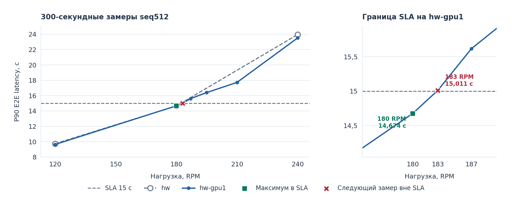

# Ускорение инференса Qwen3-8B

| Этап | Что измерено | Попытки | С итоговыми метриками | Без ошибок запросов |
| --- | --- | ---: | ---: | ---: |
| `tune` | Подбор конфигурации при 120 RPM, включая три ручных замера | 18 | 18 | 17 |
| `spec` | Сравнение P90 с бейзлайном на сетке от 60 до 960 RPM | 16 | 15 | 11 |
| `load` | 300-секундные замеры `seq512` на двух A100 | 11 | 10 | 10 |
| **Всего** | | **45** | **43** | **38** |

В число запусков вошли 42 автоматические попытки замера AIPerf с `result.json` и три ручных замера. Пять прогонов завершились с ошибками отдельных запросов, два прервались до экспорта итоговых метрик. Для `hw-gpu1` из раннего `tune` сохранён только выбор победителя. [Архив замеров](results) · [Выбор конфигурации на второй карте](results/hw-gpu1/tune/winners.json)

**Итог при 120 RPM.** EAGLE-3 + FlashInfer с одним черновым токеном дал **1,551×** относительно бейзлайна. Mean E2E снизился с **6,951 до 4,481 с** (−35,5%), P90 — с **9,806 до 6,552 с** (−33,2%).

**Итог по SLA.** Для `seq512` максимальная измеренная проходящая нагрузка составила **180 RPM (3 RPS)**. На той же карте при **183 RPM** P90 составил **15,011 с**, выше порога 15 с. Граница для победителя финального подбора остаётся неизмеренной.

## Методика

В автоматических сериях использовала NVIDIA A100-SXM4-80GB, по одной карте на инстанс. Бейзлайн — vLLM 0.22.0 с настройками движка по умолчанию. AIPerf 0.13.0 подавал запросы с постоянным интервалом. Во всех 640 строках исходного `data/requests.jsonl` заданы модель `Qwen/Qwen3-8B`, стриминг, `enable_thinking=false`, температура 0, seed 42 и лимит 512 токенов. Полный прогон `tune` или `spec` охватывает все 640 запросов. Перед измеряемой фазой скрипт сбрасывает prefix cache через `/reset_prefix_cache` и отправляет 40 запросов для прогрева. [Dockerfile](Dockerfile) · [Датасет](data/requests.jsonl) · [Метаданные GPU и конфигураций](results/hw/experiment.json) · [Скрипт замера](benchmark.sh)

## 1. Tune — подбор конфигурации при 120 RPM

Ускорение считала как `S = Mean E2E бейзлайна / Mean E2E конфигурации`. Ранжировала прогоны по Mean E2E и дополнительно сравнивала P90. Значения задержки указаны в секундах.

### Топ-5 и бейзлайн

| Место | Конфигурация | Mean E2E, с | P90 E2E, с | S |
| ---: | --- | ---: | ---: | ---: |
| — | `baseline` | 6,951 | 9,806 | 1,000× |
| 1 | `eagle3-flashinfer-k1` | 4,481 | 6,552 | 1,551× |
| 2 | `eagle3-flashinfer-k2` | 4,539 | 7,177 | 1,531× |
| 3 | `eagle3` | 4,890 | 8,022 | 1,421× |
| 4 | `flashinfer` | 6,261 | 8,440 | 1,110× |
| 5 | `prefill256` | 6,843 | 9,728 | 1,016× |

В объединённом рейтинге два ручных прогона сравниваются с автоматическим бейзлайном по одинаковому протоколу AIPerf. В ручных артефактах нет идентификатора GPU и команды запуска сервера. Названия ручных конфигураций взяты из имён каталогов. Лучший автоматический замер — `eagle3`, **1,421×**. [Автоматическая сводка](results/hw/tune/comparison.csv) · [Ручные прогоны](results/manual)

### Все результаты при 120 RPM

| Конфигурация | Параметры | Mean E2E, с | P90 E2E, с | S | Успешные запросы / ошибки или статус |
| --- | --- | ---: | ---: | ---: | --- |
| `baseline` | vLLM 0.22.0, параметры по умолчанию, FlashAttention | 6,951 | 9,806 | 1,000× | 640 / 0 |
| `seq64` | `--max-num-seqs 64` | 6,886 | 9,715 | 1,009× | 640 / 0 |
| `seq512` | `--max-num-seqs 512` | 6,871 | 9,700 | 1,012× | 640 / 0 |
| `seq1024` | `--max-num-seqs 1024` | 6,953 | 9,781 | 1,000× | 640 / 0 |
| `seq2048` | `--max-num-seqs 2048` | 6,855 | 9,718 | 1,014× | 640 / 0 |
| `prefill256` | `--max-num-batched-tokens 256` | 6,843 | 9,728 | 1,016× | 640 / 0 |
| `prefill512` | `--max-num-batched-tokens 512` | 6,882 | 9,641 | 1,010× | 640 / 0 |
| `prefill1024` | `--max-num-batched-tokens 1024` | 6,975 | 9,855 | 0,997× | 640 / 0 |
| `prefill4096` | `--max-num-batched-tokens 4096` | 6,871 | 9,665 | 1,012× | 640 / 0 |
| `flashinfer` | `--attention-backend FLASHINFER` | 6,261 | 8,440 | 1,110× | 640 / 0 |
| `sglang` | SGLang 0.5.10, BF16 | — | — | — | Зависимость отсутствует |
| `ngram2` | N-gram, до 2 черновых токенов | 8,557 | 12,695 | 0,812× | 640 / 0 |
| `ngram4` | N-gram, до 4 черновых токенов | 8,151 | 12,412 | 0,853× | 640 / 0 |
| `draft_qwen3_06b` | Черновик Qwen3-0.6B, до 4 токенов | 9,598 | 14,542 | 0,724× | 640 / 0 |
| `draft_qwen3_17b` | Черновик Qwen3-1.7B, до 4 токенов | 8,871 | 13,625 | 0,784× | 640 / 0 |
| `draft_qwen35_08b` | Черновик Qwen3.5-0.8B, до 4 токенов | — | — | — | При инициализации `Invalid model_type qwen3` |
| `eagle3` | EAGLE-3, до 3 черновых токенов | 4,890 | 8,022 | 1,421× | 640 / 0 |
| `suffix` | Suffix decoding, до 16 черновых токенов | — | — | — | Зависимость отсутствует |
| `eagle3-flashinfer-k1` | EAGLE-3 + FlashInfer, 1 черновой токен | 4,481 | 6,552 | 1,551× | 640 / 0 |
| `eagle3-flashinfer-k2` | EAGLE-3 + FlashInfer, до 2 черновых токенов | 4,539 | 7,177 | 1,531× | 640 / 0 |
| `eagle3-flashinfer-k3` | EAGLE-3 + FlashInfer, до 3 черновых токенов | 4,628 | 7,753 | — | 639 / 1 † |

† Для `eagle3-flashinfer-k3` Mean и P90 рассчитаны по 639 успешным ответам. Один запрос завершился `ServerDisconnectedError`, поэтому прогон исключён из рейтинга. [Экспорт ручного прогона k=3](results/manual/eagle3-flashinfer-k3-120/profile/phase_manifest.json)

Перебор лимита последовательностей и токенного бюджета батча изменил Mean не более чем примерно на 1,6%. У `baseline` около 6,83 с из 6,95 с занимает декодирование, поэтому более заметный выигрыш дали FlashInfer и EAGLE-3. В лучшем ручном замере средний интервал между токенами снизился с 16,16 до 10,35 мс при близкой средней длине ответа (420,4 и 419,6 токена). N-gram и отдельные черновые модели увеличили среднее время декодирования на этом наборе. [Диагностика tune](results/hw/tune/comparison.csv) · [Метрики лучшего ручного прогона](results/manual/eagle3-flashinfer-k1-120/profile/profile_export_aiperf.json)

## 2. Spec — зависимость P90 от нагрузки

Для бейзлайна, N-gram с четырьмя черновыми токенами и черновика Qwen3-0.6B проверила 60, 120, 240, 480 и 960 RPM. При **60 RPM**, минимальной проверенной нагрузке, оба варианта со спекулятивным декодированием уже уступили бейзлайну. P90 составил **7,318 с** у бейзлайна, **8,965 с** у N-gram и **11,345 с** у Qwen3-0.6B. На 240 RPM разрыв вырос до 52,502 и 48,674 с соответственно. Переход от выигрыша к проигрышу для этих двух методов в измеренном диапазоне не наблюдался.


График показывает завершённые замеры без ошибок. Шкала RPM слева логарифмическая. На 480 и 960 RPM оба спекулятивных варианта получили таймауты. Точка `eagle3` из `tune` показывает выигрыш при 120 RPM (P90 8,022 с). Для EAGLE-3 сохранён замер только на этой нагрузке, поэтому порог ухудшения для него неизвестен. [Парные замеры](results/hw/spec/comparison.csv) · [Сводка пересечений](results/hw/spec/crossover.json)

Уже при 60 RPM среднее время декодирования выросло с 5,35 с у бейзлайна до 5,77 с у N-gram и 7,73 с у Qwen3-0.6B при близкой длине ответов. Это согласуется с тем, что экономии шагов декодирования в этих запусках оказалось недостаточно, чтобы окупить подготовку и проверку черновых токенов. При повышении RPM медленнее обрабатывались запросы, и разрыв с бейзлайном по P90 вырос. [Экспорты AIPerf](results/hw/spec/runs)

### Все запуски spec

| Конфигурация | RPM | Mean E2E, с | P90 E2E, с | Успешные запросы / ошибки или статус |
| --- | ---: | ---: | ---: | --- |
| `baseline` | 60 | 5,457 | 7,318 | 640 / 0 |
| `baseline` | 120 | 6,899 | 9,768 | 640 / 0 |
| `baseline` | 240 | 15,458 | 23,562 | 640 / 0 |
| `baseline` | 480 | 65,951 | 87,793 | 640 / 0 |
| `baseline` | 960 | 80,007 | 106,815 | 640 / 0 |
| `ngram4` | 60 | 5,870 | 8,965 | 640 / 0 |
| `ngram4` | 120 | 8,248 | 12,503 | 640 / 0 |
| `ngram4` | 240 | 43,317 | 76,064 | 640 / 0 |
| `ngram4` | 480 | 83,365 | 114,455 | 600 / 40 † |
| `ngram4` | 960 | 82,939 | 114,081 | 398 / 242 † |
| `draft_qwen3_06b` | 60 | 7,890 | 11,345 | 640 / 0 |
| `draft_qwen3_06b` | 120 | 9,736 | 14,959 | 640 / 0 |
| `draft_qwen3_06b` | 240 | 47,812 | 72,236 | 640 / 0 |
| `draft_qwen3_06b` | 480 | 75,649 | 116,588 | 543 / 97 † |
| `draft_qwen3_06b` | 960 | 71,938 | 112,907 | 373 / 267 † |
| `draft_qwen3_17b` | 60 | — | — | Прерван |

† Задержка для прогонов с таймаутами рассчитана по успешным ответам. Для Qwen3-1.7B первая попытка поднять сервер в `spec` завершилась ошибкой CUDA, следующая дошла до подачи запросов на 60 RPM и прервалась. [Лог ошибки CUDA](results/hw/spec/servers/draft_qwen3_17b/20261119T141326.673069Z/server.log) · [Артефакты spec](results/hw/spec/runs)

## 3. Load — максимальная нагрузка при P90 E2E < 15 с

Через `load_test.sh` подавала нагрузку **300 секунд** на каждую точку и дожидалась ответов. Границу уточнила на `hw-gpu1`. На **180 RPM (3 RPS)** P90 составил **14,674 с**, на **183 RPM (3,05 RPS)** — **15,011 с**. Точки 181 и 182 RPM не измерялись. Серия `hw` подтверждает прохождение SLA при 180 RPM, ближайшая завершённая точка с нарушением там — 240 RPM. [Граница на hw-gpu1](results/hw-gpu1/load/boundary.json) · [Граница на hw](results/hw/load/boundary.json)



### Все запуски load для seq512

| Серия | RPM | От первой до последней отправки, с | Запросы | Mean E2E, с | P90 E2E, с | SLA |
| --- | ---: | ---: | ---: | ---: | ---: | --- |
| `hw` | 120 | 298,999 | 599 | 6,921 | 9,748 | Проходит |
| `hw` | 180 | 299,334 | 899 | 10,297 | 14,660 | Проходит |
| `hw` | 210 | — | — | — | — | Прерван |
| `hw` | 240 | 299,501 | 1199 | 16,000 | 23,956 | Нарушен |
| `hw-gpu1` | 120 | 299,000 | 599 | 6,849 | 9,646 | Проходит |
| `hw-gpu1` | **180** | 299,666 | 900 | 10,284 | **14,674** | Проходит |
| `hw-gpu1` | **183** | 299,345 | 914 | 10,476 | **15,011** | Нарушен |
| `hw-gpu1` | 187 | 299,357 | 934 | 10,682 | 15,618 | Нарушен |
| `hw-gpu1` | 195 | 299,691 | 975 | 11,067 | 16,401 | Нарушен |
| `hw-gpu1` | 210 | 299,428 | 1049 | 12,045 | 17,725 | Нарушен |
| `hw-gpu1` | 240 | 299,500 | 1199 | 15,757 | 23,514 | Нарушен |

Все запросы в завершённых прогонах получили ответы. На `hw-gpu1` при переходе от 120 к 240 RPM средняя длина ответа осталась около 420 токенов, а средний интервал между токенами вырос с 15,95 до 36,79 мс. При большей нагрузке ответы в среднем декодировались дольше, и P90 пересёк порог SLA. [Замеры hw](results/hw/load/measurements.csv) · [Замеры hw-gpu1](results/hw-gpu1/load/measurements.csv) · [Экспорт AIPerf для hw-gpu1](results/hw-gpu1/load/runs/seq512)

Обе серии `load` выполнены для `seq512` с `--max-num-seqs 512`. Эта конфигурация была победителем раннего подбора на `hw-gpu1`. Для победителя финального рейтинга EAGLE-3 + FlashInfer с одним черновым токеном в архиве есть только замер при 120 RPM. [Ранний выбор конфигурации](results/hw-gpu1/tune/winners.json) · [Финальный автоматический выбор](results/hw/tune/winners.json)

## Скрипты и воспроизведение

- `serve.sh` запускает Qwen3-8B с переданными параметрами движка. Автоматические конфигурации перечислены в `experiments.py`. Фактические команды запуска сохранены в `command.txt`. [serve.sh](serve.sh) · [experiments.py](experiments.py) · [Команды tune](results/hw/tune/servers) · [Команды spec](results/hw/spec/servers) · [Команды load](results/hw-gpu1/load/servers)
- `benchmark.sh` вызывает AIPerf и сохраняет команду в `command.txt`. `load_test.sh` запускает тот же бенчмарк с 300-секундной подачей запросов. `results.py` читает метрики AIPerf, проверяет подачу нагрузки и строит графики автоматических серий. [benchmark.sh](benchmark.sh) · [load_test.sh](load_test.sh) · [results.py](results.py)

В Git сохраняются графики отчёта, сводки, команды, статусы запусков и агрегированные метрики AIPerf. Для пересчёта интервала подачи по временам отдельных запросов нужен полный локальный экспорт `profile_export.jsonl`. [.gitignore](.gitignore)

На GPU-сервере для первого запуска соберите образ командой `docker build -t hw-inference .`. Подключите каталог ДЗ к тому же образу и выберите нужную карту через `--gpus`.

```bash
docker run --rm -it --init --gpus 'device=0' --ipc=host --workdir /work \
  --mount "type=bind,src=$PWD,dst=/work" \
  -v hw-inference-hf:/root/.cache/huggingface \
  hw-inference
```

Внутри контейнера команды для независимого повтора подбора и серии `spec` сохраняют замеры в отдельный каталог. Команда `load` в оркестраторе выбирает текущего автоматического победителя из `tune`.

```bash
python experiments.py --out results/repeat tune
python experiments.py --out results/repeat spec --rpm 60 120 240 480 960
```

Чтобы воспроизвести измеренную границу для `seq512`, запустите сервер командой `bash serve.sh --max-num-seqs 512`. После готовности сервера в другом терминале контейнера выполните следующие команды.

```bash
bash load_test.sh 180 results/repeat-load/180rpm
bash load_test.sh 183 results/repeat-load/183rpm
```

Для ручного замера EAGLE-3 + FlashInfer с одним черновым токеном используйте следующую конфигурацию сервера. После его готовности запустите `bash benchmark.sh results/repeat-manual/eagle3-flashinfer-k1-120 120` в другом терминале контейнера. Для остальных ручных вариантов замените `num_speculative_tokens` на 2 или 3 и укажите соответствующий каталог результатов.

```bash
bash serve.sh --attention-backend FLASHINFER \
  --speculative-config '{"method":"eagle3","model":"RedHatAI/Qwen3-8B-speculator.eagle3","num_speculative_tokens":1}'
```
