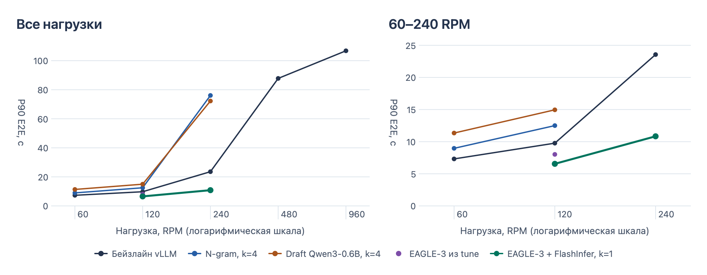

# Ускорение инференса Qwen3-8B

Лучшее ускорение при 120 RPM — **S = 1,551×** с **EAGLE-3 + FlashInfer** при одном спекулятивном токене на шаг. За счёт ускорения декодирования средняя задержка снизилась с **6,951 до 4,481 с** (−35,5%).

При 240 RPM эта конфигурация дала **P90 10,837 с** против **23,562 с** у бейзлайна. В отдельном 300-секундном тесте она выдержала **240 RPM (4 RPS)** с **P90 10,918 с**.

| Этап | Что сделано | Попыток замера | С метриками | Без ошибок запросов |
| --- | --- | ---: | ---: | ---: |
| `tune` | Подбор конфигурации при 120 RPM | 18 | 18 | 17 |
| `spec` | Сравнение P90 при 60–960 RPM | 17 | 16 | 12 |
| `load` | 300-секундные замеры `seq512` и `eagle3-flashinfer-k1` | 14 | 13 | 12 |
| **Всего** | | **49** | **47** | **41** |

## Методика

- Один инстанс Qwen3-8B на NVIDIA A100-SXM4-80GB. Бейзлайн — vLLM 0.22.0 с настройками по умолчанию.
- AIPerf 0.13.0 подавал 640 исходных запросов из `data/requests.jsonl` с постоянным интервалом в `tune` и `spec`. Параметры запросов — стриминг, без reasoning, температура 0, seed 42, до 512 новых токенов. Перед измерением сбрасывался prefix cache и выполнялся прогрев из 40 запросов. [Датасет](data/requests.jsonl) · [Скрипт замера](benchmark.sh)

## 1. Tune — ускорение при 120 RPM

`S = Mean E2E бейзлайна / Mean E2E конфигурации`.

1. Сначала были подобраны значения `seq` (лимит последовательностей, `--max-num-seqs`) и `prefill` (токенный бюджет батча, `--max-num-batched-tokens`). На этом же этапе были проверены `ngram2`, `ngram4` и две черновые модели, Qwen3-0.6B и Qwen3-1.7B. Лучший результат дал `prefill256` — **1,016×**, средняя задержка снизилась примерно на **1,6%**. N-gram и обе черновые модели увеличили задержку.
2. Затем были добавлены FlashInfer и EAGLE-3. По отдельности они дали **1,110×** и **1,421×** соответственно. Их комбинация достигла **1,551×**. Средний интервал между токенами сократился с 16,16 до 10,35 мс при примерно одинаковой длине ответов. [Метрики подбора](results/hw/tune/comparison.csv) · [Метрики лучшей конфигурации](results/manual/eagle3-flashinfer-k1-120/profile/profile_export_aiperf.json)

В названии `eagle3-flashinfer-k1` **k** — максимальное число спекулятивных токенов на шаг (`num_speculative_tokens`). Проверены значения **1, 2 и 3**.

Для режима `draft_model` vLLM требует одинаковый размер словаря. У Qwen3-8B он равен **151 936**, у Qwen3.5-0.8B — **248 320**. При запуске vLLM распознал Qwen3.5-0.8B как MTP, а слой MTP завершил инициализацию с ошибкой `Invalid model_type qwen3`, поскольку тип целевой модели Qwen3 для него несовместим. [Код vLLM](https://github.com/vllm-project/vllm/blob/v0.22.0/vllm/config/speculative.py) · [Конфиг Qwen3-8B](https://huggingface.co/Qwen/Qwen3-8B/blob/main/config.json) · [Конфиг Qwen3.5-0.8B](https://huggingface.co/Qwen/Qwen3.5-0.8B/blob/main/config.json)

### Топ-5 и бейзлайн

| Место | Конфигурация | Mean E2E, с | P90 E2E, с | S |
| ---: | --- | ---: | ---: | ---: |
| — | `baseline` | 6,951 | 9,806 | 1,000× |
| 1 | `eagle3-flashinfer-k1` | 4,481 | 6,552 | 1,551× |
| 2 | `eagle3-flashinfer-k2` | 4,539 | 7,177 | 1,531× |
| 3 | `eagle3` | 4,890 | 8,022 | 1,421× |
| 4 | `flashinfer` | 6,261 | 8,440 | 1,110× |
| 5 | `prefill256` | 6,843 | 9,728 | 1,016× |

### Все результаты при 120 RPM

| Конфигурация | Параметры | Mean E2E, с | P90 E2E, с | S | Запросы / ошибки или статус |
| --- | --- | ---: | ---: | ---: | --- |
| `baseline` | vLLM 0.22.0, параметры по умолчанию, FlashAttention | 6,951 | 9,806 | 1,000× | 640 / 0 |
| `seq64` | `--max-num-seqs 64` | 6,886 | 9,715 | 1,009× | 640 / 0 |
| `seq512` | `--max-num-seqs 512` | 6,871 | 9,700 | 1,012× | 640 / 0 |
| `seq1024` | `--max-num-seqs 1024` | 6,953 | 9,781 | 1,000× | 640 / 0 |
| `seq2048` | `--max-num-seqs 2048` | 6,855 | 9,718 | 1,014× | 640 / 0 |
| `prefill256` | `--max-num-batched-tokens 256` | 6,843 | 9,728 | 1,016× | 640 / 0 |
| `prefill512` | `--max-num-batched-tokens 512` | 6,882 | 9,641 | 1,010× | 640 / 0 |
| `prefill1024` | `--max-num-batched-tokens 1024` | 6,975 | 9,855 | 0,997× | 640 / 0 |
| `prefill4096` | `--max-num-batched-tokens 4096` | 6,871 | 9,665 | 1,012× | 640 / 0 |
| `ngram2` | N-gram, до 2 черновых токенов | 8,557 | 12,695 | 0,812× | 640 / 0 |
| `ngram4` | N-gram, до 4 черновых токенов | 8,151 | 12,412 | 0,853× | 640 / 0 |
| `draft_qwen3_06b` | Черновик Qwen3-0.6B, до 4 токенов | 9,598 | 14,542 | 0,724× | 640 / 0 |
| `draft_qwen3_17b` | Черновик Qwen3-1.7B, до 4 токенов | 8,871 | 13,625 | 0,784× | 640 / 0 |
| `draft_qwen35_08b` | Черновик Qwen3.5-0.8B, до 4 токенов | — | — | — | Ошибка инициализации |
| `flashinfer` | `--attention-backend FLASHINFER` | 6,261 | 8,440 | 1,110× | 640 / 0 |
| `eagle3` | EAGLE-3, до 3 черновых токенов | 4,890 | 8,022 | 1,421× | 640 / 0 |
| `eagle3-flashinfer-k1` | EAGLE-3 + FlashInfer, 1 черновой токен | 4,481 | 6,552 | 1,551× | 640 / 0 |
| `eagle3-flashinfer-k2` | EAGLE-3 + FlashInfer, до 2 черновых токенов | 4,539 | 7,177 | 1,531× | 640 / 0 |
| `eagle3-flashinfer-k3` | EAGLE-3 + FlashInfer, до 3 черновых токенов | 4,628 | 7,753 | — | 639 / 1 † |
| `sglang` | SGLang 0.5.10, BF16 | — | — | — | Зависимость отсутствует |
| `suffix` | Suffix decoding, до 16 черновых токенов | — | — | — | Зависимость отсутствует |

† При `k=3` один запрос завершился ошибкой `ServerDisconnectedError`. Задержки рассчитаны по 639 успешным ответам, прогон исключён из рейтинга.

## 2. Spec — P90 в зависимости от нагрузки

- `eagle3-flashinfer-k1` быстрее дефолтного vLLM на обеих проверенных нагрузках. На **120 RPM** P90 составил **6,552 с** против **9,768 с**, а на **240 RPM** — **10,837 с** против **23,562 с**. Для этой конфигурации переход к проигрышу пока не наблюдался, а нагрузки выше 240 RPM ещё не замерены. Обе серии по 640 запросов завершились без ошибок. [Замер на 120 RPM из tune](results/manual/eagle3-flashinfer-k1-120/profile/profile_export_aiperf.json) · [Замер на 240 RPM](results/spec-quick/eagle3-flashinfer-k1/240rpm/profile/profile_export_aiperf.json)
- При **60 RPM**, минимальной проверенной нагрузке, P90 у `ngram4` и Qwen3-0.6B уже был выше бейзлайна — **8,965 и 11,345 с** против **7,318 с**. Подготовка и проверка черновых токенов могли перекрыть экономию на декодировании. На 240 RPM разрыв вырос, на 480 и 960 RPM появились таймауты. Переход от выигрыша к проигрышу для этих методов не наблюдался.
- Для EAGLE-3 без FlashInfer при 120 RPM получен P90 **8,022 с**. Для этой конфигурации есть одна точка из `tune`. [Сравнение P90](results/hw/spec/comparison.csv)



### Все запуски spec

| Конфигурация | RPM | Mean E2E, с | P90 E2E, с | Запросы / ошибки или статус |
| --- | ---: | ---: | ---: | --- |
| `baseline` | 60 | 5,457 | 7,318 | 640 / 0 |
| `baseline` | 120 | 6,899 | 9,768 | 640 / 0 |
| `baseline` | 240 | 15,458 | 23,562 | 640 / 0 |
| `baseline` | 480 | 65,951 | 87,793 | 640 / 0 |
| `baseline` | 960 | 80,007 | 106,815 | 640 / 0 |
| `ngram4` | 60 | 5,870 | 8,965 | 640 / 0 |
| `ngram4` | 120 | 8,248 | 12,503 | 640 / 0 |
| `ngram4` | 240 | 43,317 | 76,064 | 640 / 0 |
| `ngram4` | 480 | 83,365 | 114,455 | 600 / 40 † |
| `ngram4` | 960 | 82,939 | 114,081 | 398 / 242 † |
| `draft_qwen3_06b` | 60 | 7,890 | 11,345 | 640 / 0 |
| `draft_qwen3_06b` | 120 | 9,736 | 14,959 | 640 / 0 |
| `draft_qwen3_06b` | 240 | 47,812 | 72,236 | 640 / 0 |
| `draft_qwen3_06b` | 480 | 75,649 | 116,588 | 543 / 97 † |
| `draft_qwen3_06b` | 960 | 71,938 | 112,907 | 373 / 267 † |
| `draft_qwen3_17b` | 60 | — | — | Прерван |
| `eagle3-flashinfer-k1` | 240 | 7,169 | 10,837 | 640 / 0 |

† Mean и P90 в строках с таймаутами рассчитаны по успешным ответам. Для Qwen3-1.7B зафиксированы ошибка CUDA при старте и прерванный замер на 60 RPM. [Лог ошибки CUDA](results/hw/spec/servers/draft_qwen3_17b/20261119T141326.673069Z/server.log)

## 3. Load — максимальная нагрузка при P90 E2E < 15 с

### Лучшая конфигурация из tune

Для `eagle3-flashinfer-k1` нагрузка подавалась **300 секунд** на каждой точке. Самая высокая проверенная нагрузка — **240 RPM (4 RPS)**. На ней **P90 E2E составил 10,918 с**, все 1199 запросов завершились успешно. Граница SLA выше 240 RPM остаётся неизвестной, поскольку при этой конфигурации ещё не замеряли более высокие нагрузки.


| RPM | От первой до последней отправки, с | Успешные / ошибки | Mean E2E, с | P90 для SLA, с | Статус |
| ---: | ---: | ---: | ---: | ---: | --- |
| 120 | 299,002 | 598 / 1 | 4,477 | 6,671 † | В SLA |
| 180 | 299,331 | 899 / 0 | 5,437 | 7,948 | В SLA |
| **240** | 299,500 | 1199 / 0 | 7,300 | **10,918** | В SLA |

† На 120 RPM один запрос завершился ошибкой `ServerDisconnectedError`. Для SLA указан скорректированный P90 AIPerf с учётом ошибки. P90 по успешным ответам — **6,654 с**. [120 RPM](results/load-eagle3-flashinfer-k1/120rpm/profile/profile_export_aiperf.json) · [180 RPM](results/load-eagle3-flashinfer-k1/180rpm/profile/profile_export_aiperf.json) · [240 RPM](results/load-eagle3-flashinfer-k1/240rpm/profile/profile_export_aiperf.json)

При повышении нагрузки со 120 до 240 RPM средний интервал между токенами вырос с 10,31 до 16,90 мс при близкой средней длине ответа. Это согласуется с ростом P90.

### Предыдущие замеры seq512

Для `seq512` максимальная проверенная нагрузка в SLA — **180 RPM (3 RPS)** при P90 до **14,674 с**. При **183 RPM** P90 достиг **15,011 с**, SLA нарушен. Значения 181 и 182 RPM не проверялись.

| RPM | От первой до последней отправки, с | Запросы | Mean E2E, с | P90 E2E, с | Статус |
| ---: | ---: | ---: | ---: | ---: | --- |
| 120 | 299,000 | 599 | 6,849 | 9,646 | В SLA |
| 120 | 298,999 | 599 | 6,921 | 9,748 | В SLA |
| 180 | 299,334 | 899 | 10,297 | 14,660 | В SLA |
| **180** | 299,666 | 900 | 10,284 | **14,674** | В SLA |
| **183** | 299,345 | 914 | 10,476 | **15,011** | Вне SLA |
| 187 | 299,357 | 934 | 10,682 | 15,618 | Вне SLA |
| 195 | 299,691 | 975 | 11,067 | 16,401 | Вне SLA |
| 210 | 299,428 | 1049 | 12,045 | 17,725 | Вне SLA |
| 210 | — | — | — | — | Прерван |
| 240 | 299,500 | 1199 | 15,757 | 23,514 | Вне SLA |
| 240 | 299,501 | 1199 | 16,000 | 23,956 | Вне SLA |

При повышении нагрузки со 120 до 240 RPM средний интервал между токенами вырос примерно с 16 до 37 мс при близкой длине ответа. Более медленное декодирование увеличило P90. [Замеры нагрузки](results)

## Скрипты и воспроизведение

- Параметры автоматического перебора заданы в `experiments.py` и передаются в `serve.sh`. Команда запуска `eagle3-flashinfer-k1` приведена ниже. [experiments.py](experiments.py) · [serve.sh](serve.sh)
- Для замеров использован `benchmark.sh`. `load_test.sh` задаёт длительность 300 секунд. [benchmark.sh](benchmark.sh) · [load_test.sh](load_test.sh)
- Для пересчёта нагрузки по временам отправки нужен полный `profile_export.jsonl`. В Git сохранены агрегированные метрики и команды. [.gitignore](.gitignore)

### Базовый запуск

Из каталога задания собирается образ и запускается контейнер. [Dockerfile](Dockerfile)

```bash
docker build -t hw-inference .
mkdir -p results
docker run --rm -it --init --gpus 'device=0' --ipc=host \
  --mount "type=bind,src=$PWD/results,dst=/homework/results" \
  -v hw-inference-hf:/root/.cache/huggingface \
  hw-inference
```

Внутри контейнера этапы автоматического перебора запускаются последовательно.

```bash
python experiments.py tune
python experiments.py spec
python experiments.py load
```

### Воспроизведение отдельных замеров

Для воспроизведения нагрузки сервер запускается с `bash serve.sh --max-num-seqs 512`, затем в другом терминале выполняются команды.

```bash
bash load_test.sh 180 results/repeat-load/180rpm
bash load_test.sh 183 results/repeat-load/183rpm
```

Для лучшей конфигурации сервер запускается с EAGLE-3 и FlashInfer.

```bash
bash serve.sh --attention-backend FLASHINFER \
  --speculative-config '{"method":"eagle3","model":"RedHatAI/Qwen3-8B-speculator.eagle3","num_speculative_tokens":1}'
```

В другом терминале можно повторить замер при фиксированном числе запросов и 300-секундные прогоны.

```bash
bash benchmark.sh results/repeat/eagle3-flashinfer-k1-120 120
bash benchmark.sh results/repeat/eagle3-flashinfer-k1-240 240

for rpm in 120 180 240; do
  bash load_test.sh "$rpm" "results/repeat-load/eagle3-flashinfer-k1/${rpm}rpm"
done
```
